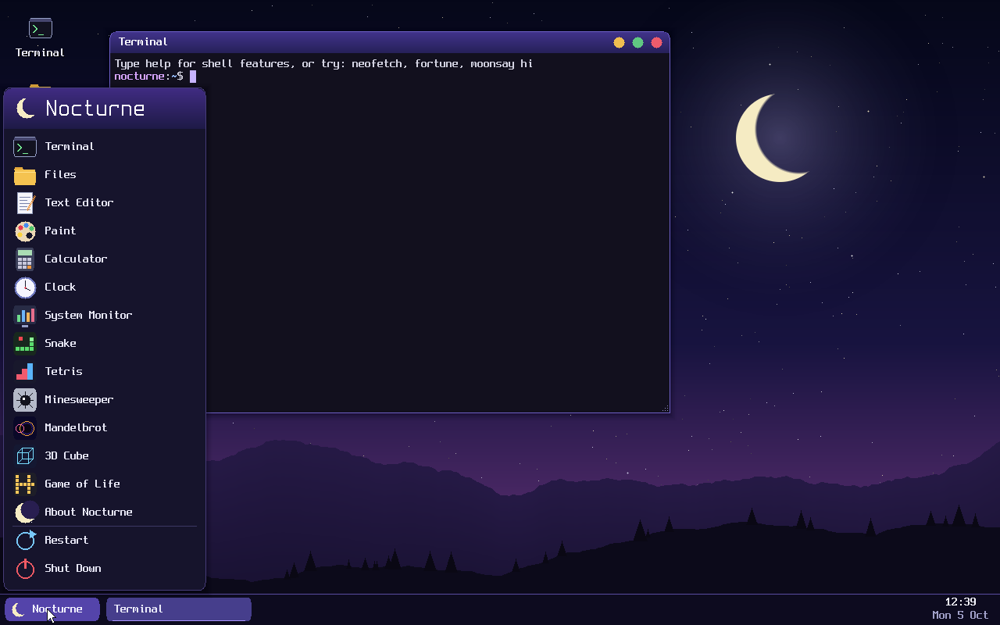
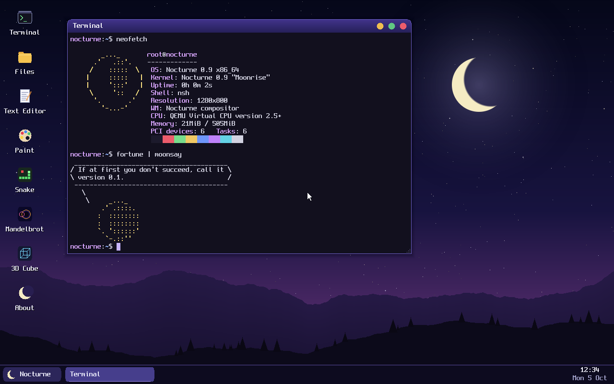
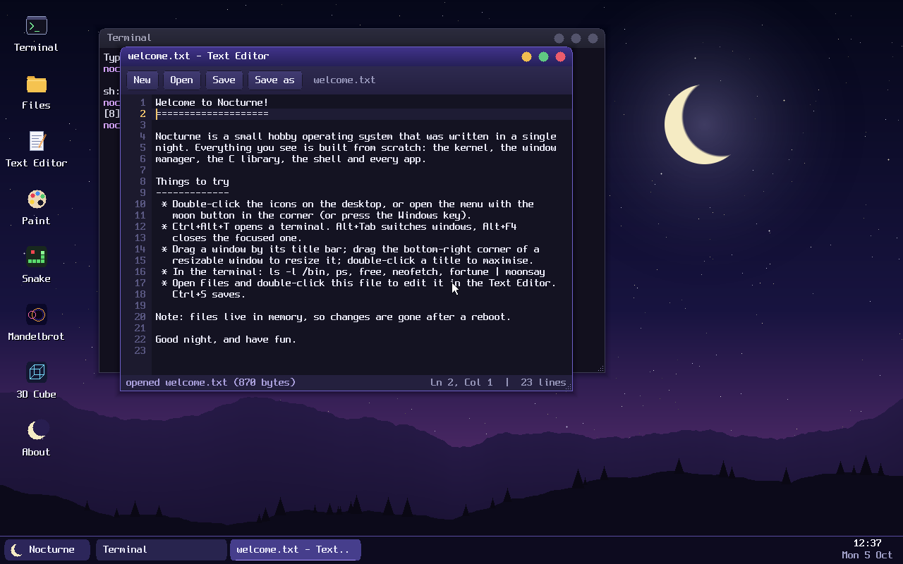
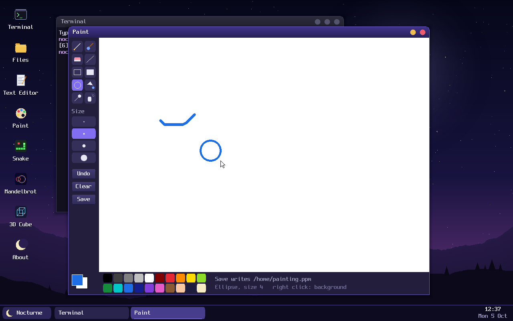
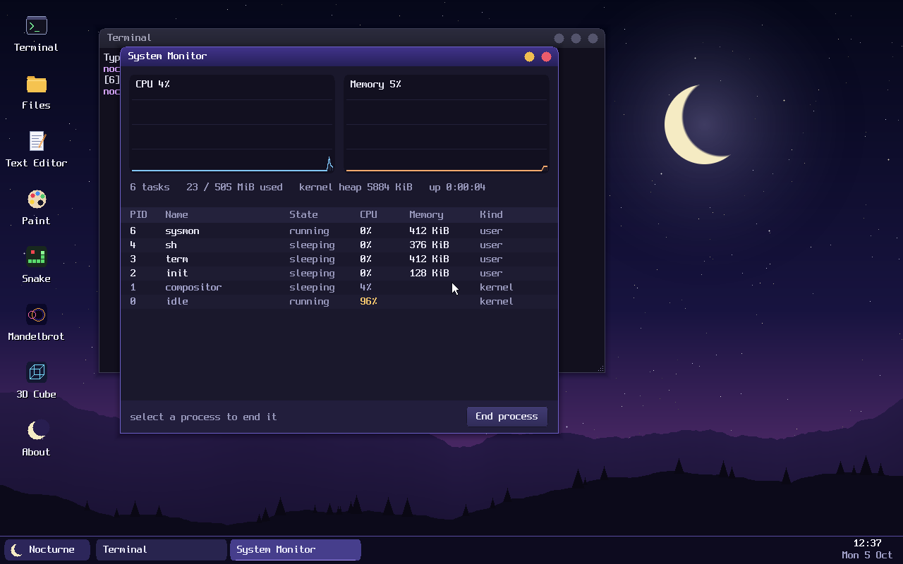
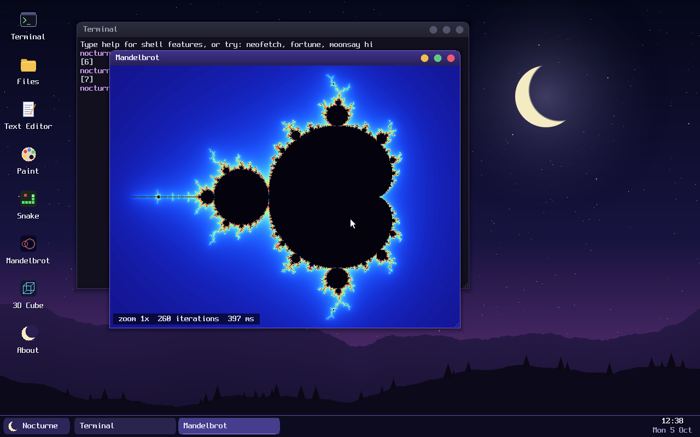
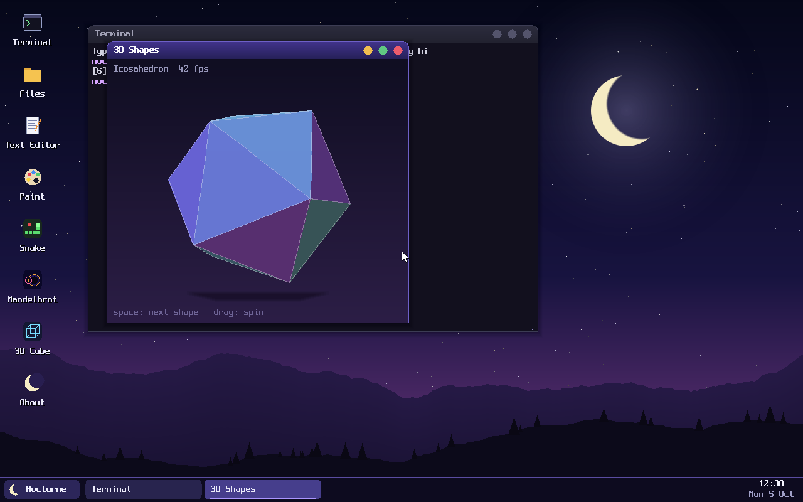
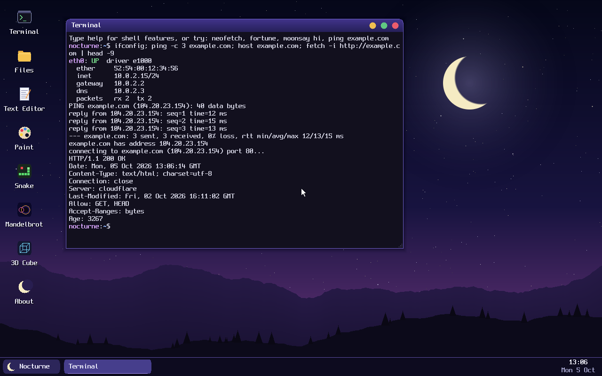
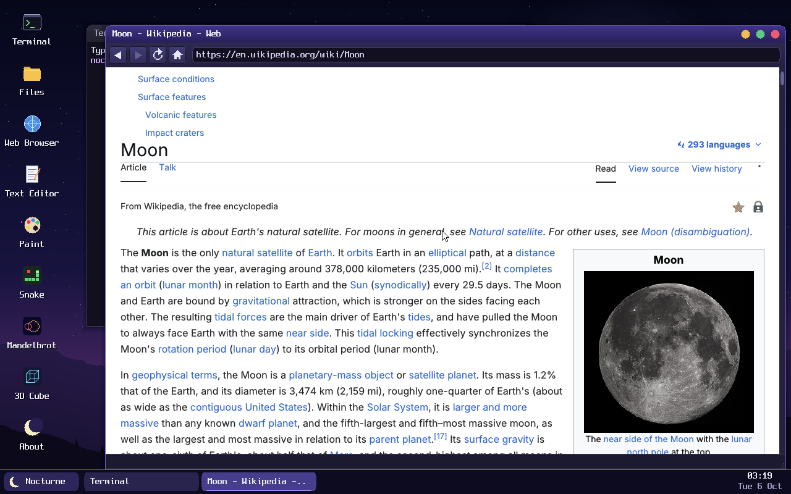
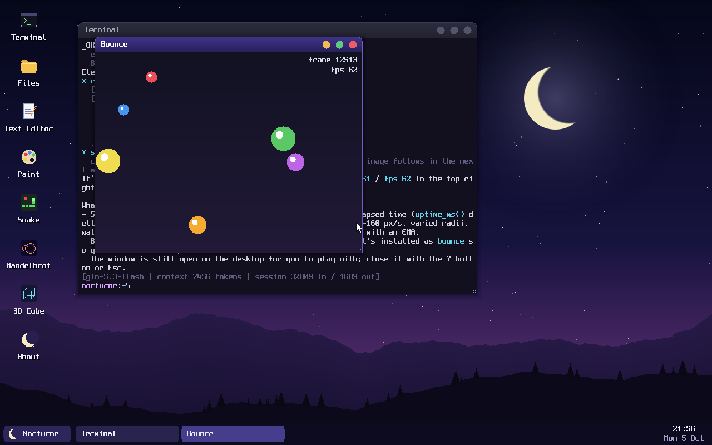

# Nocturne OS

*静かな夜のための、小さなオペレーティングシステム。*

[English](README_EN.md)

Nocturne は、ゼロから書いた x86-64 の趣味の OS です。カーネル、合成ウィンドウマネージャー、
TCP/IP、C ライブラリー、Web ブラウザーのエンジン、シェル、端末、約 55 本のアプリが入っています。
AI のコーディング支援（Claude Code など）と長い対話を重ねて書きました。

**Nocturne は UNIX でも POSIX でもありません。** GUI を第一にした独自の OS で、プログラムは
Nocturne 独自のネイティブ API（文書・フォルダー・チャンネル・アプリ・イベントのハンドル）で
システムを使います。`fork`、ファイル記述子、シグナル、`unistd.h` はありません。
他の OS のプログラムは、Nocturne を合わせるのではなく、プログラムの側をネイティブ API へ移植します。

主に仮想マシン（QEMU と Hyper-V）で動かしていますが、実機でも USB メモリーから起動し、
デスクトップ、ブラウザー、USB キーボード・マウス、有線 LAN が動くところまで来ています。
おもちゃの OS であり、日常に使える汎用 OS ではありません（[制約](#制約)）。



| | |
|---|---|
|  |  |
|  |  |
|  |  |

## 特徴

- **カーネル**：Limine で BIOS・UEFI から起動。複数 CPU で動くユーザースレッド、公平スケジューラー「継」、
  W^X を守るメモリー管理、ネイティブのシステムコール ABI。
- **デスクトップ**：カーネル内の合成ウィンドウマネージャー。影、二重バッファー、タスクバー、スタートメニュー、
  通知、クリップボード、夜空の壁紙。既定の解像度は 1920×1080。
- **Web ブラウザー**：HTML の木構築に Lexbor、JavaScript に QuickJS を使い、DOM・CSS・レイアウト・描画・
  Web API は Nocturne で実装しています。Worker、IndexedDB、WebSocket、WebGL（Mesa のソフトウェア描画）、
  WebAssembly、動画（FFmpeg、MSE）、開発者ツールがあります。
- **ネットワーク**：自前の TCP/IP（TCP の接続と待受け、ウィンドウスケーリング、ループバック）、DHCP、DNS、
  HTTP/1.1・HTTP/2、BearSSL による TLS 1.2。
- **開発**：OS の中で C をコンパイルする TinyCC、JavaScript・TypeScript の実行環境 `js`、
  TypeScript 7 のコンパイラー `tsgo`、Go の移植（`GOOS=nocturne`）、ホストからの C++20。
- **AI エージェント**：`agent` が HTTPS で LLM につながり、コマンドの実行、C の作成とコンパイル、
  画面の確認までを OS の中で行います。
- **Hyper-V**：第 2 世代 VM の合成デバイス、統合サービス、拡張セッション（RDP サーバー）。

## 中身

### カーネル（`kernel/`、C とアセンブリーで約 43,000 行）

- **起動**：Limine（BIOS・UEFI）から上位半分の 64 ビットカーネルへ。起動メニューには既定の
  1920×1080、1024×768、文字コンソールだけ（`nogui`）の 3 項目があります。
- **CPU**：最大 16 CPU。CPU 0（BSP）がカーネル、割り込み、ドライバー、GUI、ネットワークを持ち、
  ほかの CPU（AP）はそれぞれ自分の実行キューでアプリのスレッドを動かします。
  - スケジューラー「継」（`sys/kei.c`、`sys/sched.c`）：重み付きの仮想時間による公平な選択、
    AP ごとのキュー、空いた AP によるスレッドの取得、切替えの費用を考えた保持。
  - IPI による TLB の撃ち落とし、PCID、XSAVE による AVX 状態の保存、
    実機での CPPC・HWP による最高性能の設定、サンプリングによるプロファイラー（`prof`）。
  - 時計は 1 kHz のローカル APIC タイマー（無ければ PIT）。刻みは TSC か Hyper-V の参照時計から求めます。
- **メモリー**：4 段のページング、アプリごとのアドレス空間、カーネルヒープ。
  - W^X：書込み可能かつ実行可能なページは作りません。生成したコードは書いてから実行可能へ切り替えます。
  - ネイティブのメモリー API（`n_memory_reserve`・`protect`・`release`）と共有ページ。
    共有ページはチャンネルのメッセージに添付してだけ他のアプリへ渡せます。
- **ファイル**：起動ディスクの Nocturne パーティションがドライブ C: です（`fs/`）。独自のコピーオンライト形式で、
  4 KiB のブロック、B+ 木の目録、全ブロックの CRC-32C、交互に書く 2 つのスーパーブロックを持ち、
  書込み中に電源が切れても最後のコミットが残ります。カーネルは Limine が伝える起動ディスクの GPT の GUID で C: を見つけます
  （ライブ ISO では、Limine がメモリーへ読んだボリュームが C: です）。
- **ドライバー**
  - 記憶装置：AHCI（SATA、DMA）、ATA（PIO）、NVMe、USB 大容量記憶装置（BOT＋SCSI）、Hyper-V の SCSI。
  - USB：xHCI、USB 2.0 と SuperSpeed のハブ、HID のキーボード・マウス。
  - 入力：PS/2 のキーボードとホイールマウス、Hyper-V の合成キーボードと絶対座標マウス、USB HID。
  - ネットワーク：Intel e1000、DEC 21140／21143（tulip）、Hyper-V の合成アダプター、
    Realtek RTL8125B（2.5GbE）、USB Ethernet（CDC ECM／NCM）。
  - 画面：Limine が渡すフレームバッファー。virtio-gpu（virgl）は試験的で、既定では使いません（`gpu-enable`）。
  - 音：Intel AC'97 と、拡張セッションへの音声送信。
  - そのほか：ACPI の表（電源断と再起動）、PCI と PCIe ECAM、MSI／MSI-X、PAT、CMOS 時計、シリアル、乱数。
- **GUI**：ウィンドウマネージャーはカーネルのスレッドで動きます。単純で速い反面、その不具合はシステム全体を止めます。
  - 窓の画素はアプリと共有するメモリーで、変わった部分だけを描き直します。合成と画面への転送は AP にも分けます。
  - 二重バッファーの窓と描画完了のイベント（`EV_FRAME`）、合成の周期（既定 120 Hz、設定アプリで変更）。
  - 8 bpc と 10 bpc の色：ファームウェアの画面が 10 bpc（2:10:10:10）なら、合成は 10 ビットの深い面を保ち、
    窓は `WIN_DEEP_COLOR` で 10 ビットの画素を出せます。8 bpc の画面では、壁紙と 10 ビット動画を
    規則的なディザで 8 ビットへ落とし、段差を出しません。設定アプリの「10-bit colour」を On にすると、8 bpc の
    画面の上でも 10 bpc で描き、表示の直前にディザします（再起動なしで切り替わります）。
  - 影、角の丸いタイトルバー、移動・大きさの変更・最大化・最小化・全画面。
  - タスクバー（スタートボタン、窓のボタン、音量、日付と時刻）、スタートメニュー、通知、1 MiB までのクリップボード。
  - カーネルの文字は GNU Unifont Japanese 18.0.01 のビットマップ（57,086 字形、半角 8×16・全角 16×16）です。
- **設定**：設定アプリ（デスクトップの歯車、スタートメニューの Settings）で、画面（10-bit colour、更新頻度）、
  マウス（ポインターの速さ、縦方向の向き）、音量をマウスだけで変えられます。変更はすぐ効き、ユーザーのフォルダーの
  `AppData\Settings\desktop.conf` に保存して再起動後も残ります。起動時に端末は開きません。端末を開かなくても普段の操作はすべてできます。
- **Hyper-V**：VMBus と合成デバイス、ハートビート、Hyper-V マネージャーからの終了と再起動、時刻の同期、
  KVP（VM の IP アドレスと OS を表示）、Hyper-V ソケット、その上の拡張セッション用 RDP サーバー。

### ネイティブ API

プログラムから見た Nocturne です（`user/include/nocturne.h`、`common/abi.h`、
設計は [docs/nocturne-native-abi.md](docs/nocturne-native-abi.md)）。

- **ハンドル**：資源はすべて種類付きのハンドルです（文書、フォルダー、チャンネル、窓、共有ページ、アプリ、
  イベント、装置、接続）。失敗は負の `N_ERR_*` で返り、`n_result_text` で説明を得られます。
- **文書とフォルダー**：いつも完全なパス（`C:\Users\User\a.txt`。`\` と `/` は同じで、`\a` は `C:\a`）で扱います。
  名前は大文字と小文字を区別せず、書いたとおりに残ります。カーネルには作業フォルダーも読み書き位置もありません。
  シェルの現在のフォルダーは設定 `FOLDER=` でアプリへ渡ります。文書全体の読込み・原子的な保存・追記、
  位置を指定した読み書き、排他の取得があります。
- **チャンネル**：双方向のメッセージ通信で、パイプの代わりです。文書や共有ページのハンドルを添付できます。
  名前を付けて待ち受け、接続することもできます。
- **アプリ**：`n_app_launch` で引数・設定・渡すハンドルを指定して起動し、`n_app_result` で結果を受け、
  `n_app_stop` で止めます。シグナルはありません。端末は設定 `TERMINAL=0 1 2`、Ctrl+C は `INTERRUPTS=3` の
  チャンネルに届くメッセージです。
- **イベント**：レベル型のイベントキューで、受信可能・送信可能・終了・アプリ終了・タイマー・アドレスを待ちます。
- **スレッド**：`thread_create` などのネイティブスレッドと、アプリをまたいで使える `wait_on_address`。
  C11 の `<threads.h>` もあります。
- **そのほか**：音声ストリーム（`n_audio_*`）、窓（`win_open` など）、時計、乱数、システム情報、
  TCP・UDP・DNS（下の[ネットワーク](#ネットワーク)）。

その上に ISO C のライブラリー（`stdio`、`stdlib`、`string`、`math`、`time`、`threads` など）があります。
POSIX のヘッダー（`unistd.h`、`fcntl.h`、`sys/*.h`）は意図して用意していません。

### ユーザーランド（`user/`）

- **libc**：ネイティブ API と ISO C11 の一部（正しく丸める浮動小数点の `printf`、`strtod`、`qsort`、`setjmp` など）。
  - HTTP/1.1・HTTP/2 と HTTPS のクライアント、JSON の解析と組立て、PNG の書出し。
  - 描画（`gfx.h`）、TrueType（`font.h`）、画像の読込み（`image.h`）、FFmpeg による音声・動画の復号（`media.h`）、
    並列処理（`parallel.h`）。
  - Web エンジン（`user/libc/web/`、C で約 54,000 行と JavaScript で約 42,000 行）。[Web ブラウザー](#web-ブラウザー)を参照。
- **UI エンジン**（`user/libc/ui.c`、`ui.h`）：アプリの画面（ボタン、入力欄、一覧など）を作る一つのエンジンです
  （端末やマンデルブロ集合のように画素だけを描くアプリは、窓へ直接描きます）。
  アプリは部品の木（ビュー：列、行、文字、ボタン、入力欄、一覧、スイッチ、スライダー、キャンバス、サーフェス）を
  メッセージで送り、部品の場所を名指すイベントを受けます。配置、描画、ポインターとキーボード、フォーカス、
  スクロール、アニメーションはエンジンが受け持ち、前の絵から変わった部品だけを描き直します。
  C はそのまま呼び、JavaScript・TypeScript（`nocturne/ui`）と Go（`ports/go/ui`）は `C:\Nocturne\System\uihost` を通して
  同じ形式で使います。言語ごとの部品の実装はありません。文字は Noto Sans（CJK を含む）、等幅は Maple Mono です。
- **シェル**（`sh`）
  - パイプ（チャンネル）、リダイレクト（`< > >> 2>`）、`&`、`;`、`&&`、`||`、引用符、`*` と `?` の展開（大文字・小文字を区別しない）、`#` の注釈。
  - `$?` とスクリプトの引数（`$0`〜`$9`、`$#`、`$@`）。変数、`if`、繰返しはありません。
  - 履歴、Tab 補完、`cd`・`pwd`・`history`・`help`。
- **端末**：16 色の ANSI、UTF-8、1000 行のスクロールバック、画面のコピーと貼付け、大きさの変更。
  全角文字は 1 マスで表示され、2 マス幅の処理はまだありません。
- **コマンド**：`ls cat cp mv rm mkdir rmdir touch tree grep wc head hexdump echo sleep date uptime uname
  ps kill free dmesg lspci clear true false reboot poweroff neofetch fortune moonsay screenshot`
- **ネットワーク**：`ifconfig`、`ping`、`host`（DNS）、`fetch`（HTTP・HTTPS）。
- **音**：`beep`（音と旋律）、`play`（WAV）、`volume`。どれもデスクトップからもできることで、スクリプト用です。
- **開発**：`tcc`、`js`、`tsgo`、`wasm2c`、`cppdemo`。プログラムは `C:\Nocturne\System`（コマンド）と `C:\Programs`
  （デスクトップのアプリ）にあり、C・JavaScript・TypeScript のソースは `C:\Nocturne\SDK\Source\Apps` にあります。
- **AI**：`agent`（[AI エージェント](#ai-エージェント)）。
- **デスクトップのアプリ**：端末、ファイル、Web ブラウザー、テキストエディター、ペイント、電卓、時計、
  システムモニター、ピアノ、サウンドプレーヤー、メディアプレーヤー、設定、Nocturne について。
- **ゲームとおもちゃ**：スネーク、テトリス、マインスイーパー（3 つとも効果音付き）、マンデルブロ集合、3D 図形、ライフゲーム。

## 動かす

### QEMU

[ビルド](#ビルド)のあと、次のどちらかで QEMU を起動します。

```powershell
powershell -ExecutionPolicy Bypass -File build.ps1 run
```

`build.ps1 run`（`make run`）は既定で 2048 MiB、4 CPU、TCG（エミュレーション）です。
`make run QEMU_ACCEL=whpx QEMU_MEMORY=4096M` のように変数で変えられます。
音は AC'97、ネットワークは QEMU 既定の e1000 とユーザーモードの NAT です。
起動するのは自分用のディスク `build\run.img` です。最初は `build\nocturne.img` をコピーし、その後のビルドでは
中のシステムだけを置き換えるので、C: に保存したファイルは残ります（[ドライブ C: と保存](#ドライブ-c-と保存)）。

カーネルの ATA ドライバーは PIO なので、起動ディスクは AHCI（DMA）につなぎます。ビルドしたディスクを
そのまま試すときの構成は次のとおりです（`snapshot=on` なので、C: への書込みは QEMU の終了で捨てられます）。

```powershell
& "C:\Program Files\qemu\qemu-system-x86_64.exe" -M pc -accel whpx -smp 4 -m 4096M -vga std `
  -device ahci,id=ahci `
  -drive id=boot,file=build/nocturne.img,format=raw,if=none,snapshot=on `
  -device ide-hd,drive=boot,bus=ahci.0,bootindex=0 `
  -audiodev dsound,id=snd -device AC97,audiodev=snd -serial stdio
```

### Hyper-V

Hyper-V を有効にした Windows で、このフォルダーから**管理者の** PowerShell で一度だけ実行します。

```powershell
powershell -ExecutionPolicy Bypass -File hyperv.ps1 -MemoryMB 4096
```

`Nocturne` という名前の**第 2 世代** VM を作り、起動して VMConnect を開きます。設定は次のとおりです。
- 静的メモリー（既定は 512 MB）と 1 CPU。メモリーは `-MemoryMB` で変えられます（開発の試験は 4096 MiB で
  行っています）。CPU 数は Hyper-V マネージャーで増やせ、カーネルは増やした CPU を使います。
- セキュアブートは無効（ブートローダーは署名されていません）。チェックポイントなし。
- ディスクは 1 台（`hyperv\<名前>.vhdx`、SCSI 0:0）で、その VM 専用です。最初は `build\nocturne.img` のコピーで、
  起動部分と[ドライブ C:](#ドライブ-c-と保存) が入っています。
- ネットワークアダプターは **Default Switch** につなぐので、DHCP でアドレスを得てインターネットへ出られます。
- 拡張セッションは Hyper-V ソケットで使います。ホストで拡張セッションモードが切れていれば、スクリプトが有効にします。
- COM1 は `\\.\pipe\<名前の小文字>-com1` につながります。

**拡張セッション**：Nocturne が起動すると、VMConnect が画面の大きさを尋ねます。VMConnect は Nocturne の中の
RDP サーバーにつながり、デスクトップは選んだ大きさになります。窓の大きさを変えると、デスクトップもそれに合わせます。
キーボードとマウス（マウスのキャプチャーなし）、クリップボードの文字（Windows でコピーしたものを Nocturne の
エディターやアドレス欄で Ctrl+V、端末では Ctrl+Shift+V。逆方向は Ctrl+C、端末の画面は Ctrl+Shift+C）、
音（VMConnect の**ローカル リソース > リモート オーディオ**が既定の「このコンピューターで再生する」のとき）も
同じ接続で届きます。**表示 > 拡張セッション**で基本のコンソールに戻すと、フレームバッファーの大きさで表示します。

そのほかの使い方：

| コマンド | 内容 |
|---|---|
| `hyperv.ps1 -Update` | VM を止め、新しくビルドしたシステム（起動部分、`C:\Nocturne`、付属アプリのフォルダー）を VM のディスクへ入れて起動し直します。ユーザーのファイルと、ユーザーが `C:\Programs` に入れたアプリは残ります。書換えには `hyperv\` にディスクの 2 倍の空きが要ります。古い版の VM のデータディスク（`<名前>-data.vhdx`）は外し、ホストに残します。 |
| `hyperv.ps1 -Generation 1` | 第 1 世代の VM を作ります（下記）。 |
| `hyperv.ps1 -Iso` | ディスクの代わりにライブ ISO（`build\nocturne.iso`）を DVD ドライブから起動します。C: はメモリー上にあり、変更は電源を切ると消えます。`-MemoryMB` を指定しなければ 2048 MB にし、既存の VM に `-Update -Iso` とすると、起動メモリーが足りなければ引き上げます。 |
| `hyperv.ps1 -Remove` | VM を削除します。ディスクはユーザーのファイルごと残り、同じ名前で作り直した VM がまた使います。`-DeleteDisk` を付けるとディスクも消します。 |
| `hyperv.ps1 -NoStart` | VM を作るだけで起動しません。 |
| `hyperv.ps1 -NoNetwork` | ネットワークアダプターなしで作ります。 |
| `hyperv.ps1 -Switch "名前"` | 別の仮想スイッチにつなぎます。 |
| `hyperv.ps1 -Name Foo -MemoryMB 4096` | VM の名前とメモリーを変えます。 |
| `hyperv.ps1 -Update -ApiKeyFile KEYFILE` | AI エージェントの API キーを VM のディスクの C: へ書きます（`-Endpoint`、`-Model` も指定可）。 |

手で第 2 世代の VM を作るなら、セキュアブートを切って `build\nocturne.vhdx` を SCSI ディスクとしてつなぎ、
拡張セッションには `Set-VM -EnhancedSessionTransportType HvSocket` を設定します。

**第 1 世代**は旧来の PC を模倣します。ディスクは固定長の VHD（`hyperv\<名前>.vhd`、`build\nocturne.vhd` と同じ形式）で
IDE 0:0 に、*レガシー*ネットワークアダプター（DEC 21140 の模倣）をつなぎます。VMConnect は基本のコンソールだけです。

**VMConnect のこつ**
- 基本のコンソールでは、窓の中をクリックするとマウスを捕まえます。**Ctrl+Alt+←** で離します。
- Windows キーは全画面のときしか VM へ届きません。スタートメニューは **Ctrl+Esc** で開けます。
- 1920×1080 が使えない環境のために、起動メニューに 1024×768 と文字コンソールだけの項目があります。
  1920×1080 が無いときは Limine がファームウェアのモードを選びます。
- カーネルのログは COM1 です。PuTTY などの名前付きパイプのクライアント（Serial、`\\.\pipe\nocturne-com1`）で
  見られます。`scripts\hv-serial.ps1` はファイルへ書き写します。
- **下へ動かすとマウスが上へ動く場合**：第 1 世代では、Windows 11 ホストの Hyper-V が模倣 PS/2 マウスの縦軸を
  逆に報告します。Nocturne は Hyper-V（とホストのビルド）を見分けて自分で軸を反転します。合わないときは
  設定アプリの Mouse で「Up and down」を Normal（または Inverted）にしてください。すぐ効き、再起動後も残ります。

**開発用のスクリプト**（`scripts\`、管理者で実行）：

| スクリプト | 内容 |
|---|---|
| `hv-boot.ps1 -Name VM -Build` | ビルドし、VM の ISO、またはディスクのシステム（`hyperv.ps1 -Update -NoStart`）を新しくして起動し、COM1 を記録してコンソールを撮ります。 |
| `hv-esm.ps1 -Name VM` | VMConnect で拡張セッションを開き、窓の画像を保存します。 |
| `python hv-rdp.py --vm VM --size 1280x720 "type:neofetch\n" dclick:53,130` | VMConnect なしで拡張セッションを試します。小さな RDP クライアントが打鍵・クリックし、受け取った画面を PNG に保存します。`clip:TEXT` と `chord:1d,2a,2f` はクリップボード、`resize:1600x900` は窓の大きさの変更を試します。受け取った音は PNG の隣に WAV で保存し、含まれる音の高さを一覧にします。 |
| `hv-input.ps1 -Name VM -Steps "text:...","click:1"` | 基本のコンソールへキーボードとマウスの入力を送ります。 |
| `hv-shot.ps1 -Name VM` | VMConnect なしで VM のコンソールを撮ります。 |
| `hv-sock.ps1 -Name VM -Port N` | ホストからゲストの Hyper-V ソケットのサービスへつなぎます。 |
| `hv-serial.ps1 -Pipe P -Log F` | COM ポートのパイプをログファイルへ書き写します。 |

### 実機

`build\nocturne.img`（GPT の起動ディスク、BIOS・UEFI の両方で起動）を USB メモリーへ書き込み、
セキュアブートを切って起動します。12 スレッドの AMD 機（USB 起動、RTL8125B の有線 LAN、USB の
キーボード・マウス）で、デスクトップとブラウザーでの動画ページの表示まで確認しました。この確認は 1 台のディスクと
ドライブ C: の形式になる前のもので、今の形式の実機ではまだ確かめていません。まだ初期段階です。
- 手順書や対応機種の一覧はありません。
- 音は出ません（HD Audio は未対応）。GPU のドライバーはなく、ファームウェアの画面モードを使います。
- ファイルは USB メモリーの C: に保存され、再起動しても残ります。C: の大きさはイメージのままで
  （USB メモリーが大きくても広がりません）、空きは約 2 GB です。

## ビルド

ホストは Windows です。ツール一式は `tools/` に置きます（リポジトリーには含まれず、`.gitignore` されています）。
- `tools/msys64`：MSYS2（UCRT64）。clang 22、lld、nasm、mtools、xorriso、Python、make、QEMU。
- `tools/limine`：Limine のバイナリー。
- `tools/mesa-tools`：Mesa の解析器を作り直すときの bison・flex・m4。
- ホストの LLVM 18.1.8（`C:\Program Files\LLVM\bin`、`NOCTURNE_LLVM_BIN` で変更可）：C++ のアプリと
  WebAssembly の部分に使います。libc++ は llvm-project の `llvmorg-18.1.8` から取り出し
  （`NOCTURNE_LLVM_SOURCE`）、`build/cxx` に保存して使い回します。

```powershell
powershell -ExecutionPolicy Bypass -File build.ps1          # すべてを .\build へビルド
powershell -ExecutionPolicy Bypass -File build.ps1 run      # ビルドして QEMU で起動
powershell -ExecutionPolicy Bypass -File build.ps1 clean    # build を消す（run.img は残す）
python -X utf8 scripts/build.py -j 8 cxx                    # Makefile の任意の目標（cxx、bitmap-fonts など）
```

`build\` にできるもの：
- `kernel.elf`：カーネル。
- `nocturne.img`：GPT の起動ディスク（EFI システムパーティションとドライブ C:。QEMU、USB メモリー）。
- `nocturne.vhd`：Hyper-V 第 1 世代用の固定長 VHD。
- `nocturne.vhdx`：Hyper-V 第 2 世代用の可変長 VHDX。
- `nocturne.iso`：BIOS・UEFI 両用のライブ ISO。Limine、カーネル、C:（`boot/c.img`、GPT の無い単独のボリューム）が入り、
  Limine が C: をモジュールとしてメモリーへ読みます。C: への変更は電源を切ると消え、ハイバネーションはできません。
  C: の空きは 256 MiB 以上（今は約 390 MiB）で、C: の大きさ分（今は約 960 MiB）の RAM を使います。全体のビルドで作り、
  `qemu-image` と `run` では作りません。
- `run.img`：`build.ps1 run` 専用のディスク。最初の `run` で作り、その後はシステムだけを置き換えます。
- `host\store.exe`：ホストで C: を作り、読み書きし、検査する道具（`store list`、`get`、`put`、`check` など）。

**追加の部品**（無くても OS はビルドできます。ただし電卓は Go、設定と「Nocturne について」は TypeScript で
書かれているので、揃ったデスクトップには両方が要ります。`tools/go` と `tools/typescript-go` に置けば自動で使います）：
- **Go**（[ports/go](ports/go/README.md)）：Go 1.27.2 に `ports/go/nocturne.patch` を当ててビルドし、
  `make GO=<Go のソース>/bin/go.exe` とすると `ports/go/apps/*` が `C:\Nocturne\System`（電卓は `C:\Programs\Calculator`）に入ります。
- **TypeScript-Go**（[ports/tsgo](ports/tsgo/README.md)）：さらに `TSGO=<TypeScript-Go のソース>` を付けると
  `C:\Nocturne\System\tsgo` が入ります。`js file.ts` は tsgo を使います。
- **virgl**（[ports/virgl](ports/virgl/README.md)）：ホストの QEMU で virtio-gpu を試すときだけ使います（`QEMU_GPU=virgl`）。

## 試験

```powershell
powershell -ExecutionPolicy Bypass -File build.ps1 test        # 全体の試験（時間がかかります）
powershell -ExecutionPolicy Bypass -File build.ps1 test-quick  # 全アプリのコンパイルと tcc の自己ビルドを省く
powershell -ExecutionPolicy Bypass -File build.ps1 test-full   # OS の中で tcc が自分をビルドし直す試験も行う
```

`scripts/test.py` は `build\nocturne.img` のコピー（`build\test.img`）の `C:\Tests` に `tests/` を入れ、
画面なしの QEMU で起動します。コピーのカーネルとプログラムが今のビルドのものかを先に確かめ、`run.img` には触れません。
OS の中の `tcc` が試験の実行役（`tests/runtests.c`）をコンパイルし、約 110 の群・約 220 の試験を走らせ、
終了状態と出力を確かめます。結果はシリアルで返り、最後にホストが `store check` で OS が書いた C: を検査します
（問題があったときだけコピーを残します）。主な対象は次のとおりです。
- シェルとコマンド、`malloc`、ネイティブ ABI、スレッドと並列処理。
- W^X：コードや読込み専用データへの書込み、スタックやヒープの実行がアプリを止めること。
- ドライブ C:：4 KiB のブロックの境目をまたぐさまざまな大きさ、置換・追記・大きさの変更・位置を指定した書込み、
  移動、長い名前、大文字と小文字、入れ子のフォルダー、一覧、削除。
- `tcc`：printf と数学関数、全アプリのコンパイル、自己ビルド。C++。
- GUI：窓が画面に現れ、閉じると消えること。
- 音：ストリーム、待つ書込みと待たない書込み、8 本同時、音量、`beep`、各種 WAV の `play`。QEMU が AC'97 の出力を
  `build/test-audio.wav` に録り、ホストが各音の高さ・左右・長さを確かめます。媒体の復号も試します。
- Web エンジン：要素の位置、描いた画素、CSS、フォーム、文字コード、URL、Worker、IndexedDB、WebAssembly、
  WPT と html5lib の一部。壊れた・深く入れ子のページで落ちないこと。
- ネットワーク：DHCP、ping、DNS、HTTP、HTTPS、不正な証明書の拒否、HTTP/2、TLS の再開。
- TCP：ホストのサーバーとの 14 MiB の送受信（損失と順序の入替えの模擬あり）、全バイトの照合。
- エージェント：オフラインで、API キーは要りません。

ネットワークの試験はホストからインターネットへ出られる必要があります。出られないときは
`python scripts/test.py --no-net` を使います。`--accel whpx`、`--cpus`、`--memory`、群の名前
（`python scripts/test.py web tcp`）も指定できます。

`scripts/qtest.py` は `build\nocturne.img` を `snapshot=on` で起動し（C: への書込みは終了で捨てられます）、
打鍵・マウス・画面の撮影で操作します。

```
python scripts/qtest.py sleep:6 "type:neofetch\n" shot:neofetch goto:51,125 dclick shot:files
```

## 使い方

| キー | 動作 |
|---|---|
| Super または Ctrl+Esc | スタートメニュー（矢印キーと Enter で選べます） |
| Ctrl+Alt+T | 新しい端末 |
| Alt+Tab | 前面の窓を一番後ろへ回す |
| Alt+F4 | 窓を閉じる |
| タイトルバーをダブルクリック | 最大化と元に戻す |
| 右下の角をドラッグ | 大きさの変更（端末、ファイル、テキストエディター、時計、マンデルブロ集合、3D 図形、Web ブラウザー） |
| Ctrl+Shift+C / Ctrl+Shift+V | 端末の画面のコピー／貼付け |
| Shift+PgUp / PgDn、ホイール | 端末のスクロールバック |
| Ctrl+C | 実行中のコマンドを止める |

端末とアプリはユーザーのフォルダー `C:\Users\User` で始まります。`Documents` には見本のファイルがあります。
`sh Documents\hello.sh` を試してみてください。`Documents\JavaScript` には `js` の見本があります。

### ドライブ C: と保存

ディスクは 1 台で、EFI システムパーティション（Limine とカーネル）とドライブ C: があります。C: はコピーオンライトの
格納庫で、保存したファイルは再起動しても残ります。
- `C:\Nocturne`：システム（`System` のプログラム、`Fonts`、`SDK`、`Licenses` など）。アプリは読めますが、変えられません。
- `C:\Programs`：デスクトップのアプリ（`Browser`、`Notepad` など、アプリごとのフォルダー）。システムと一緒に入る
  アプリのフォルダーは `C:\Nocturne` と同じく変えられません。自分のアプリのフォルダーはここに作れます。
- `C:\Users\User`：ユーザーのファイル（`Documents`、`Desktop`、`Downloads`、`Music`、`Pictures`、`Videos`）。
  アプリのデータは `AppData\<アプリ>`、一時ファイルは `AppData\Temp`（起動のたびに空になります）。
- 書き込んだ内容は、最初の変更から約 5 秒後か、文書を閉じたときにコミットされます。書込みの途中で電源が切れても、
  最後のコミットまでの内容が残ります。

保存先：
- **QEMU**：`build.ps1 run` の `build\run.img`。ビルドし直してもシステムだけを置き換え、`build.ps1 clean` も消しません。
  まっさらにしたいときは手で消してください。
- **Hyper-V**：VM のディスク（`hyperv\<名前>.vhdx`）。`-Update` はシステムだけを置き換えます。
- **実機**：USB メモリーの C:。
- ライブ ISO の C: はメモリー上にあり、変更は電源を切ると消えます。

ホストからは `build\host\store.exe` で C: を見られます（`store list build\run.img C:\Users\User`、`store get`、`store put`）。

シェルは名前だけのコマンドを `C:\Nocturne\System` と、`C:\Programs` の各フォルダーから探します（`PATH` はありません）。
`C:\Programs\<名前>` に入れたプログラムは名前だけで動きます。

## 音

- **音量**：タスクバーの時計の隣のスピーカーをクリックします。つまみをドラッグすると変わり（新しい音量で短く鳴ります）、
  パネルの中のスピーカーで消音します。タスクバーのスピーカーの上でホイールを回しても変わります。
  パネルには音の出先（サウンドカード、または拡張セッションのリモートデスクトップ）も表示します。
- **サウンドプレーヤー**：ファイルで `.wav` をダブルクリックするか、デスクトップやスタートメニューから開きます。
  同じフォルダーの他の音も一覧にして続けて再生します。再生・一時停止、停止、前、次、クリックやドラッグで移動できる
  バーがあります。Space で再生・一時停止、←→ で 5 秒移動、↑↓ で曲を変えます。PCM の WAV（8/16/24/32 ビット、
  浮動小数点、モノラルから多チャンネル、任意の標本化周波数）を読みます。
- **メディアプレーヤー**：MP3、FLAC、AAC、Ogg（Vorbis、Opus）の音声と、MP4・WebM・AVI・MOV の動画
  （H.264、HEVC、VP8、VP9 など）を FFmpeg で再生します。ファイルで音声・動画をダブルクリックすると開きます。
  Space で再生・一時停止、←→ で 5 秒移動、Ctrl+O でファイルや URL を開きます。
- **音楽**：`C:\Users\User\Music` に Nocturne 用の短い曲が 3 つあります（ビルド時に `scripts/mksounds.py` が合成）。
- **ピアノ**：マウスかキーボードで 2 オクターブを弾けます（下のオクターブは Z S X D C V G B H N J M、
  上は Q 2 W 3 E R 5 T 6 Y 7 U I）。Tab で 3 種類の音色、←→ でオクターブを変えます。
- スネーク、テトリス、マインスイーパーには効果音があります。

音は Intel AC'97 から出ます。`build.ps1 run` は QEMU に AC'97 を付けて Windows のスピーカーで鳴らします。
Hyper-V にはサウンドカードがないので、拡張セッションが VMConnect へ運びます。拡張セッションの外では、
音は再生されるのと同じ速さで捨てられます（プログラムの所要時間は音の長さどおりです）。

**プログラムから**：`n_audio_open` でストリームを開き、`n_audio_submit` で 48 kHz・ステレオ・16 ビットの
フレームを送ります。約 170 ms 分がたまると待ち（`N_AUDIO_WAIT`）、`n_audio_status` で再生済みの量を知って
画面と音を合わせられます。8 本まで同時に鳴らせます。ゲーム向けには、待たずに短い音や雑音を鳴らす
`sound_effect(hz, hz2, ms, wave)` と、どんな WAV も 48 kHz ステレオで読む `wav_open`・`wav_read`・`wav_seek`
があります（`nocturne.h`）。スクリプトでは `beep`、`play`、`volume` を使えます。

## ネットワーク



ネットワークはひとりでに立ち上がります。カーネルの DHCP クライアントが起動時に動くので、`ifconfig` は
ふつうデスクトップが出て 1、2 秒でアドレスを表示します。

- **QEMU**：既定の e1000 とユーザーモードの NAT がそのまま使えます。`-nic user,model=tulip` で tulip
  （Hyper-V 第 1 世代のレガシーアダプター）のドライバーを試せます。
- **Hyper-V**：第 2 世代は合成アダプター（VMBus）、第 1 世代はレガシーアダプターを使います。

```
ping -c 3 example.com
host example.com
fetch -i http://example.com
fetch -o C:\Users\User\Downloads\1mb.zip http://speedtest.tele2.net/1MB.zip
```

- **TCP/IP**（`kernel/src/net/`）：Ethernet、ARP、IPv4、ICMP、UDP、DHCP、DNS、TCP。
  - TCP は接続と待受け（RFC 9293）、ウィンドウスケーリング（RFC 7323、既定で送受信 1 MiB）、NewReno の輻輳制御、
    往復時間から求める再送時間、順序の乱れたセグメントの組立て。
  - `127.0.0.1` と自分のアドレスへのループバック。
  - DNS はキャッシュ付きで、応答が切れていれば TCP で問い直し、複数のアドレスを返します。
- **プログラムから**：ソケットではなく Nocturne の API です。`tcp_connect`・`tcp_send`・`tcp_recv`、
  サーバーは `tcp_listen`・`tcp_accept`、UDP は `udp_socket` など、名前解決は `net_resolve_all`（`nocturne.h`）。
  上位には TCP・TLS のストリームと HTTP のクライアント（`http.h`）があります。
- **HTTP**：HTTP/1.1（持続接続、チャンク、gzip）と HTTP/2（ALPN、HPACK、接続の共有）。接続は使い回します。
- **TLS**：BearSSL による TLS 1.2。証明書は libc に組み込んだ Mozilla のルート証明書で検証し、
  有効期限には CMOS の時計を使います。セッションを再開できます。Go のプログラムは Go 自身の TLS（1.3 まで）を使います。

制約：IPv6、IP の断片化、TCP の SACK とタイムスタンプはありません。使えるネットワークアダプターは 1 枚です。

## Web ブラウザー



デスクトップかスタートメニューの **Web ブラウザー**、または `browser URL`（`browser C:\パス\file.html`）で開きます。
ファイルは `.html` をブラウザーで開きます。最初のページは検索欄とリンク集です。窓ごとに 1 つの処理で、
タブの代わりに窓を増やします（`window.open` も新しい窓になります）。

**しくみ**
- HTML の字句解析と木構築は Lexbor 3.1.0、JavaScript は QuickJS（2026-06-04）。DOM は Nocturne のネイティブ DOM が
  一つだけで、CSS のカスケード、ボックスの生成とレイアウト、描画、当たり判定、Web API は Nocturne の実装です。
- 通信は別の処理 `webfetch` が持ちます（DNS、TCP、TLS、HTTP/1.1・HTTP/2、Cookie、CORS、WebSocket、キャッシュ）。
  Worker、動画の復号、MSE、IndexedDB の入出力もそれぞれ別の処理で動きます。
- スタイル、レイアウトの部分木、ラスターのタイルは複数の CPU で処理します。

**HTML と CSS**
- block、inline、inline-block、float、table、flexbox、grid、`display: contents`、相対・絶対・固定の配置、
  `::before`・`::after`。
- セレクター（`:has()`、`:is()`、`:not()`、`:nth-child()` など）、`@media`、`@supports`、`@layer`、
  カスタムプロパティ、`calc()`、CSSOM、構築可能なスタイルシート。
- 背景、線形・放射グラデーション、角丸の枠、影、`outline`、CSS マスク、2D の変形（`transform`、
  `rotate`・`scale`・`translate`）、`@keyframes` とトランジション（変形と不透明度）。
- 画像は PNG、JPEG、GIF、WebP、SVG、ICO、BMP。
- フォーム（文字入力、チェックボックス、ラジオボタン、選択、日時・数値の入力、検証、ファイルの選択）、
  ページ内検索、Shadow DOM、カスタム要素。
- 文字：既定の serif は Noto Serif、sans-serif は Noto Sans、monospace と端末は Maple Mono NF です（太字は合成）。
  日本語は Noto Sans／Serif CJK JP と Plangothic で補い、絵文字は Noto Color Emoji（COLRv1、ZWJ の連結や国旗）で描きます。
  Web フォント（`@font-face`）は FreeType で TrueType、OpenType CFF、WOFF、WOFF2、非圧縮 EOT を読みます。

**JavaScript と Web API**
- DOM、イベント、各種 Observer、Range・Selection、履歴、URL、Blob、FormData、Fetch・XHR、Streams、WebSocket。
- 専用 Worker と SharedWorker（窓をまたいで共有）、MessageChannel、BroadcastChannel。
- Cookie（SameSite、公開サフィックス一覧）、localStorage・sessionStorage、IndexedDB、OPFS。
- Canvas 2D、OffscreenCanvas、WebGL・WebGL2（Mesa の GLSL コンパイラーと softpipe によるソフトウェア描画）。
- WebAssembly：WABT で検証し、wasm2c が出した C を OS の中の TCC でネイティブコードにします。x86-64 の JIT、
  インタープリター、JSPI、共有メモリーと Atomics、スレッドがあります。
- `<video>`・`<audio>`（FFmpeg 9.0.2 の一部の復号器）、MSE、HLS・DASH、WebVTT 字幕、全画面、ピクチャーインピクチャー。
- Web Crypto（ハッシュと AES）、Intl（英語と日本語）、Trusted Types、CSP。
- 窓は UI エンジンのものです。ツールバー（戻る、進む、再読込み、ホーム、履歴の設定）、アドレス欄、ページ内検索、
  コンソールの入力欄、ステータス行はエンジンの部品で、ページ・スクロールバー・開発者ツールはその間の一つのサーフェスです。
  入力欄はエンジンが編集するので、ページの重いスクリプトが走っている間もアドレス欄に打てます。

**開発者ツール**：F12（または Ctrl+Shift+I）で、要素（DOM の木、スタイル、計算値、ボックスモデル、ページ上で選ぶ）、
コンソール、ネットワークのパネルを開きます。`browser --log-console`、`--net-log`、`--debug-js` で
コンソールと通信の記録をシステムログ（シリアル）へ出せます。

| キー | 動作 |
|---|---|
| Ctrl+L | アドレス欄（点を含まない言葉は DuckDuckGo Lite で検索） |
| Ctrl+F | ページ内検索（Enter で次へ） |
| Alt+← / Backspace、Alt+→ | 戻る、進む |
| F5 または Ctrl+R | 再読込み |
| Esc | 読込みを止める（全画面を抜ける。入力欄ではそこから抜け、検索は閉じる） |
| F12、Ctrl+Shift+I / J / C | 開発者ツール（要素／コンソール／要素の選択） |
| Space、PgUp/PgDn、矢印、ホイール | スクロール |

**実サイト**：QEMU（WHPX、4 CPU、4096 MiB、1920×1080）で確かめた例です。それぞれその日の記録であり、
動作の保証ではありません。
- 2026-10-13：DuckDuckGo の検索と結果のリンク、Reddit の検索、GitHub のメニュー、百度百科の表示。
- 2026-10-14：百度百科の本文・画像・検索・戻る進む。YouTube は再生、一時停止、シーク、スクロールまで動きましたが、
  途中の停止や字幕の重なりが残りました。CNN はトップページが表示され、動画ページは黒いままでした
  （[記録](docs/browser-wasm-delivery-20261014.md)）。
- 2026-10-16：Puter の Firefox（WebAssembly）が既定の GPU 描画で起動しました。

**まだできないこと**：TLS 1.3、Service Worker、WebRTC、Web Audio、WebGPU、モジュール Worker、
`position: sticky`、3D の変形、`clip-path` などの多くのプロパティ、OpenType の完全な文字整形と可変フォント、
AV1 と HDR、RSA・楕円曲線の署名、ダウンロードとブックマークの UI。重いページではレイアウトに数秒かかることがあります。
対応の空白は [docs/browser-missing-20261012.md](docs/browser-missing-20261012.md) にまとめています
（その後に対応したものも含みます）。

## 開発

### OS の中で C を書く

`tcc` は Nocturne 向けにビルドした TinyCC 0.9.28rc です。

```
tcc -run C:\Nocturne\SDK\Source\Apps\mandel.c   # メモリー上でコンパイルして実行
mkdir C:\Programs\Hello
tcc -o C:\Programs\Hello\hello hello.c          # プログラムを作る。以後 hello で動く
```

プログラムは Nocturne の libc と静的にリンクします。ヘッダーとライブラリーは `C:\Nocturne\SDK` にあります。使えるヘッダー：
- `nocturne.h`：ネイティブ API と窓。
- `ui.h`：UI エンジン（部品のビューとイベント。[ユーザーランド](#ユーザーランドuser)を参照）。
- `gfx.h`（描画）、`font.h`（TrueType）、`image.h`（画像）、`media.h`（音声・動画）、`gpu.h`。
- `threads.h`、`parallel.h`。
- `http.h`（HTTP と HTTPS）、`json.h`、`png.h`、BearSSL。

tcc は自分自身もコンパイルでき、そのソースから OS の中で使えるコンパイラーを作り直せます（`build.ps1 test-full`）。

### C++

ホストの clang で Nocturne 向けの C++20 アプリをクロスコンパイルできます。`user/apps/*.cpp` を置き、
`python -X utf8 scripts/build.py cxx` でビルドします。C の API はそのまま呼べます。OS の中で `cppdemo` を起動すると、
libc++ の文字列・コンテナーと C の GUI API を使う例が動きます。例外、RTTI、iostream、スレッドなどは使えません。
詳しくは [docs/cpp-support.md](docs/cpp-support.md) を参照してください。

### Go

[ports/go](ports/go/README.md) は Go を `GOOS=nocturne GOARCH=amd64` へ移植したもので、UNIX 系としてではなく
Nocturne の API の上で動きます。ゴルーチンは複数の CPU で動き、`os`、`os/exec`、`net`（TCP・UDP・DNS、
`net.Listen`）、`crypto/tls` を使えます。ホストでクロスコンパイルし、`ports/go/apps/<名前>` が
`C:\Nocturne\System\<名前>`（デスクトップのアプリは `C:\Programs\<アプリ>`）になります。

### JavaScript と TypeScript

`js` は端末で JavaScript と TypeScript を動かす実行環境（QuickJS）、`tsgo` は TypeScript 7 の
公式コンパイラーです（[ports/tsgo](ports/tsgo/README.md)）。

```
js hello.js                 # ES モジュール、CommonJS、JSON
js app.ts one two           # tsgo で型検査とコンパイルをしてから実行（引数は nocturne.args）
js --init myapp             # package.json、tsconfig.json、src/main.ts を作る
cd myapp && tsgo && js dist/main.js
js -e 'console.log(1 + 2)'  # -p は結果を表示、js - は入力から、js だけで対話プロンプト
```

- **モジュール**：`import`・`export`、トップレベルの `await`、`require`（ES モジュールも読める）、
  `import ... with { type: "json" }`。`.mjs`・`.cjs` は拡張子で、`.js` は最寄りの `package.json` の
  `"type"` で、無ければ構文で判断します。パッケージは上のフォルダーの `node_modules` から探し、
  `package.json` の `exports`（条件 `nocturne`・`import`・`require`・`default`）と `main` を使います。
- **システム**：`import { readText, writeText, list, run, args } from "nocturne"` で文書・フォルダー・
  設定・端末の入出力・アプリの起動を使えます。失敗は `code`（`"NOT_FOUND"` 等）を持つ Error です。
  Node.js の `fs` や `process` はありません（移植するのはプログラムで、Nocturne を Node に合わせません）。
- **Web の API**：`console`、`setTimeout` 等、`queueMicrotask`、`performance`、`fetch`
  （HTTP・HTTPS・data:、転送の追跡、`AbortController`）、`Headers`・`Request`・`Response`、
  `URL`、`TextEncoder`・`TextDecoder`、`crypto`（`getRandomValues`、`subtle`）、`structuredClone`、
  `atob`・`btoa`、`EventTarget`、`DOMException`。DOMException・Encoding・URL・Web Crypto は
  ブラウザーと同じ実装です。`fetch` はアプリ内のスレッドで通信し、待つ間も他の処理が進みます。
- **型**：`nocturne` の型定義は `C:\Nocturne\SDK\Types\nocturne` にあり、`js file.ts` と `js --init` の
  `tsconfig.json` はそこを使います。`js file.ts` は `--strict` で検査し、型の誤りがあれば実行しません
  （出力は一時フォルダーの `js-ts`、パッケージは元の場所から探します）。TypeScript には `tsgo` を入れたビルドが必要です。
- **終了**：捕まえられなかった例外と処理されなかった Promise の拒否はスタックを表示して状態 1、
  終わらないトップレベルの `await` は状態 13。対話プロンプトでは表示だけして続けます。

実行環境の本体は `user/apps/js.c`（システムとの接続、モジュールの読み込み、イベントループ）と
`user/apps/js_runtime.js`・`js_console.js`・`js_web.js` です。

### WebAssembly

`wasm2c` は WABT の変換器です。出力した C は、`C:\Nocturne\SDK\Include` と `C:\Nocturne\SDK\Source\wasm2c` のランタイムと一緒に
OS の中の `tcc` でコンパイルできます。

## AI エージェント



`agent` は OS の中で動くコーディングエージェントです。OpenAI 互換の chat completions のエンドポイントから
（Nocturne 自身の TLS で HTTPS を通して）返答を逐次受け取り、モデルに次の道具を渡します。
- `run_command`：シェルでコマンドを実行します。
- `read_file`、`write_file`、`edit_file`、`list_dir`。
- `fetch_url`。
- `screenshot`：モデルがデスクトップを画像として見るので、自分の書いた GUI のアプリを確かめられます。

C を書いて `tcc` でコンパイルし、実行し、壊れたところを直します。

```
agent                                   # 対話（/help で命令の一覧）
agent write a tetris clone in C:\Users\User\Documents\tetris and install it as C:\Programs\Tet\tet
agent -r                                # 前回の続き
```

モデルへの指示は `C:\Nocturne\Agent\system.md` です。設定（`agent.conf`）、会話（`session.json`）、
エージェントのメモ（`NOTES.md`）はユーザーのフォルダーの `AppData\Agent` にあります。
- `endpoint` と `model`。
- `max_tokens` と `context_limit`。
- `reasoning`、`show_thinking`、`vision`。画像を受け取れないモデルでは `vision=0` にします。

**API キー**：キーは使うディスクの C: の `AppData\Agent\agent.conf` にだけ保存し、リポジトリーやビルドした
`nocturne.img` には入れません。
- QEMU：`python scripts\setkey.py KEYFILE [--endpoint URL] [--model NAME]`（`build\run.img` に書きます。
  先に `build.ps1 run` で作ってください。別のディスクは `--img`）
- Hyper-V：`hyperv.ps1 -Update -ApiKeyFile KEYFILE`
- または `agent` を起動し、尋ねられたときに貼り付けます（`/key` で入れ直せます）。

`KEYFILE` はキーだけか、`api key: ...` という行を含むファイルです。既定は `https://hyper.charm.land/v1` と
`glm-5.3-flash` です。キーのファイルはこのフォルダーの外に置いてください。

## 制約

驚かないように、Nocturne に無いもの：
- **ユーザーと権限がありません。** アプリはそれぞれ自分のアドレス空間に隔離されますが、システムの部分（`C:\Nocturne` と
  付属アプリのフォルダー）を除き、どのアプリもすべてのファイルを読み書きできます。
- **カーネルの仕事は CPU 0 が持ちます。** アプリのスレッドは全 CPU で動きますが、システムコール、割り込み、
  ドライバー、GUI、ネットワークのほとんどは CPU 0 で処理します。
- **ウィンドウマネージャーはカーネルの中で動きます。**
- **動的リンクとスワップはありません。** プログラムはすべて静的リンクです。
- **ディスクは単純です。** AHCI と NVMe は一度に 1 命令、ATA は PIO です。ドライブは起動したディスクの C: だけで、
  他のディスクや USB メモリーの中身は読めません。名前は UTF-8 で 255 バイトまでです。
- **ネットワークの制約**は[上](#ネットワーク)のとおりです（IPv4 だけ、TLS 1.2 まで）。
- **拡張セッションは素朴です。** 画面、キーボード、マウス、音、クリップボードの文字を運びます。画像やファイルのクリップボード、
  マイク、ドライブやプリンターの共有はありません。RDP サーバーは暗号化しませんが、ホストの Hyper-V ソケットからしか
  届かず、ネットワークには出ません。
- **音は出力だけで、AC'97 か拡張セッションだけです。** HD Audio、USB オーディオ、録音はありません。
- **GPU のドライバーはありません。** 描画は CPU です（WebGL もソフトウェア描画）。
- **AI エージェントはモデルのコマンドを尋ねずに実行します。** VM の外には出ませんが、`C:\Users` のファイルを消すことはあります。
- **ブラウザーは発展途上です。** 多くのサイトは表示できますが、動かない機能や遅いページがあります（[上](#web-ブラウザー)）。
- **実機はまだ試し始めた段階です。** 確かめた機械は少なく、手順書もありません。

## フォルダー構成

```
boot/         limine.conf
common/       カーネルとユーザーランドが共有する ABI（abi.h、gpu_abi.h）、2D 描画、Unifont のビットマップ
kernel/src/   arch/（GDT、IDT、APIC、SMP、FPU、PAT、P ステート、Hyper-V の検出）、mm/、
              sys/（アプリ、スケジューラー「継」、システムコール、イベント、チャンネル、プロファイラー）、
              fs/（ドライブ C: の格納庫：ボリューム、目録、名前空間、文書）、
              dev/（AHCI、ATA、NVMe、xHCI と USB、PCI、ACPI、音、画面、入力）、
              gui/（ウィンドウマネージャー、デスクトップ）、net/（TCP/IP、e1000、tulip、RTL8125B）、
              hv/（VMBus と Hyper-V の装置）、rdp/（拡張セッションの RDP サーバー）
user/         libc/（web/ はブラウザーのエンジン）、include/、apps/（アプリ、ブラウザーの補助処理、js の .js）
rootfs/       C: へ入れるファイル（Nocturne\ はシステムの文書・フォント・型定義、Users\ は見本のファイル）
host/         ホストの道具（store：C: の作成・読み書き・検査、limine：2 GiB を超えるディスクへの Limine の導入の補い）
ports/        Nocturne への移植の設定と差分（tcc、go、rust、tsgo、lexbor、freetype、ffmpeg、mesa、nvidia、wabt、virgl）
third_party/  取り込んだソース（下のクレジット）
scripts/      起動ディスク（mkimage.sh、layout.py）と SDK（mksdk.sh）の作成、test.py、qtest.py、setkey.py、hv-*.ps1
tests/        OS の中の試験（runtests.c とそれがコンパイルするプログラム）、ホストの検査、試験用の素材
docs/         README の画像、設計の文書、作業の記録
build.ps1     ビルドの入口
hyperv.ps1    Hyper-V の VM の作成
```

`docs/` には日付付きの作業記録がたくさんあります。その時点の記録で、後の変更で古くなった記述も含みます。

## クレジット

**起動と基盤**
- [Limine](https://github.com/limine-bootloader/limine) ブートローダー（BSD-2-Clause）。
- [BearSSL](https://bearssl.org/) TLS（MIT）。
- [TinyCC](https://bellard.org/tcc/) 0.9.28rc C コンパイラー（LGPL-2.1、ソースは `third_party/tinycc`）。
- Mozilla の CA 証明書（[curl](https://curl.se/docs/caextract.html) 経由、MPL-2.0）。
- スケジューラー「継」の選択核 kei_sched（MIT、`kernel/src/sys/kei.c`）。
- RTL8125B ドライバー（`kernel/src/net/rtl8125.c`）のレジスターと初期化の手順は Realtek の FreeBSD 用ドライバー
  rtl_bsd_drv_v1102.01 に従っています。This product includes software developed by Bill Paul.
  （4 条項 BSD、全文はファイルの先頭）

**ブラウザーと JavaScript**
- [QuickJS](https://bellard.org/quickjs/) 2026-06-04（MIT、`third_party/quickjs`）。
- [Lexbor](https://lexbor.com/) 3.1.0（Apache-2.0）。
- [FreeType](https://freetype.org/) 2.14.3。FreeType Project License（FTL）を選び、代替の GPLv2 は使いません。
  Nocturne の一部は FreeType チームの成果に基づきます。
- [Brotli](https://github.com/google/brotli) 1.2.0（MIT、WOFF2 用）。
- [FFmpeg](https://ffmpeg.org/) 9.0.2 の一部の復号器（LGPL-2.1 以降、GPL の部分は無効）。
- [Mesa](https://mesa3d.org/) 26.3.0-devel の GLSL・NIR・softpipe（MIT ほか、`third_party/mesa/licenses`）。
- [WABT](https://github.com/WebAssembly/wabt) 1.0.42（Apache-2.0）。
- [FormatJS](https://formatjs.github.io/)（MIT）、Unicode CLDR と Unicode のデータ（Unicode License V3）、
  ICU 由来の照合表、IANA のタイムゾーンデータベース。
- [web-streams-polyfill](https://github.com/MattiasBuelens/web-streams-polyfill) 4.2.0（MIT）。
- [Public Suffix List](https://publicsuffix.org/)（MPL-2.0）、WHATWG Encoding の JIS0208 表（CC BY 4.0）。
- [stb_truetype と stb_image](https://github.com/nothings/stb)（Sean Barrett、パブリックドメイン）、
  [JebP](https://github.com/matanui159/jebp) WebP 復号器（MIT No Attribution）、
  [NanoSVG](https://github.com/memononen/nanosvg)（Mikko Mononen、zlib、既定の `preserveAspectRatio` を一か所変更）。

**開発**
- libc++ 18.1.8（Apache-2.0 with LLVM Exceptions、ビルド時に llvm-project から取り出します）。
- [Go](https://go.dev/) 1.27.2（BSD-3-Clause、`GO=` を指定したときだけ）。
- [TypeScript-Go](https://github.com/microsoft/typescript-go) 7.0.2（Apache-2.0、`TSGO=` を指定したときだけ）。
- ビルド時だけ使う Python のモジュール Mako、MarkupSafe、PyYAML（`third_party/python-build`、イメージには入りません）。

**フォント**（どれも SIL Open Font License 1.1。ライセンスは `rootfs/Nocturne/Fonts`）
- [GNU Unifont Japanese](https://unifoundry.com/unifont/index.html) 18.0.01 のカーネル用ビットマップ。
  原本・許諾・変換内容は `third_party/unifont/`、起動ディスク内の許諾は `C:\Nocturne\Licenses\unifont\`。
  `python -X utf8 scripts/build.py bitmap-fonts` で作り直せます。
- Maple Mono NF（未改変の TTF。各ファイルの SHA-256 は `MapleMono-manifest.json`）。
- [Noto](https://fonts.google.com/noto) の Sans／Serif、Sans／Serif CJK JP、Color Emoji。
- Plangothic（Fitzgerald P. Köeingsegg）。

それ以外はすべて Nocturne のために書いたものです。
